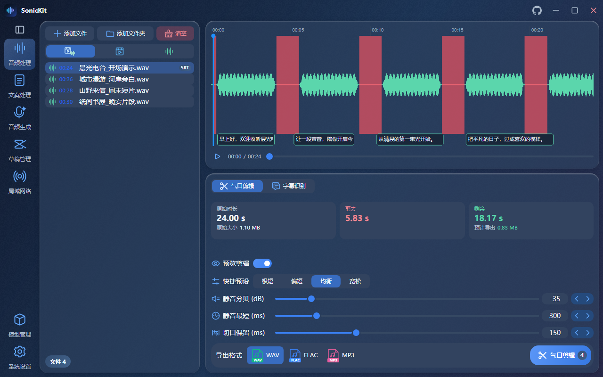
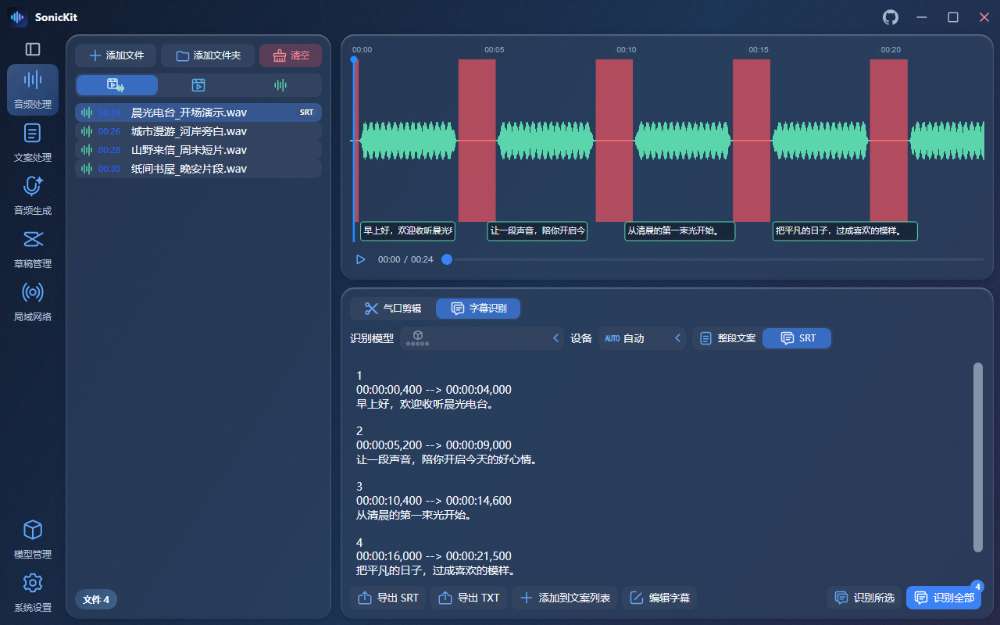
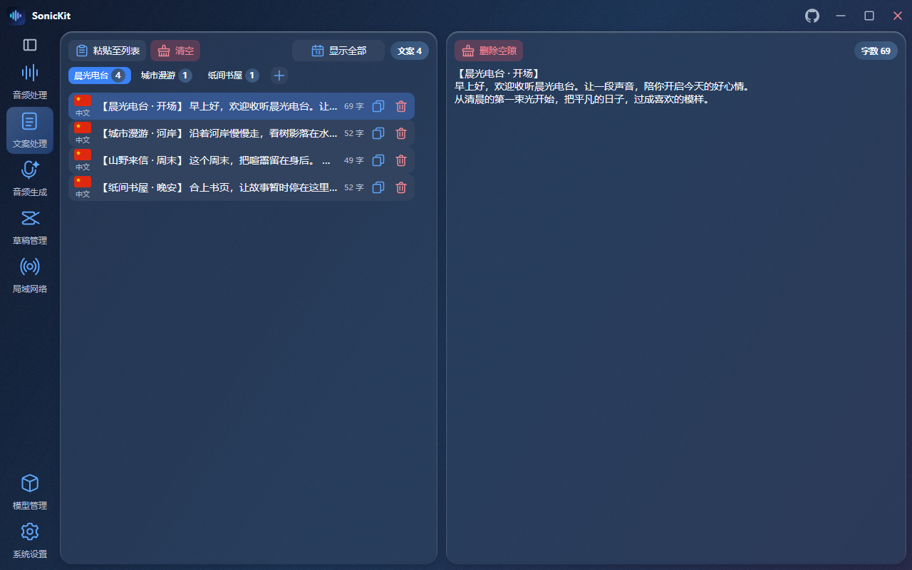
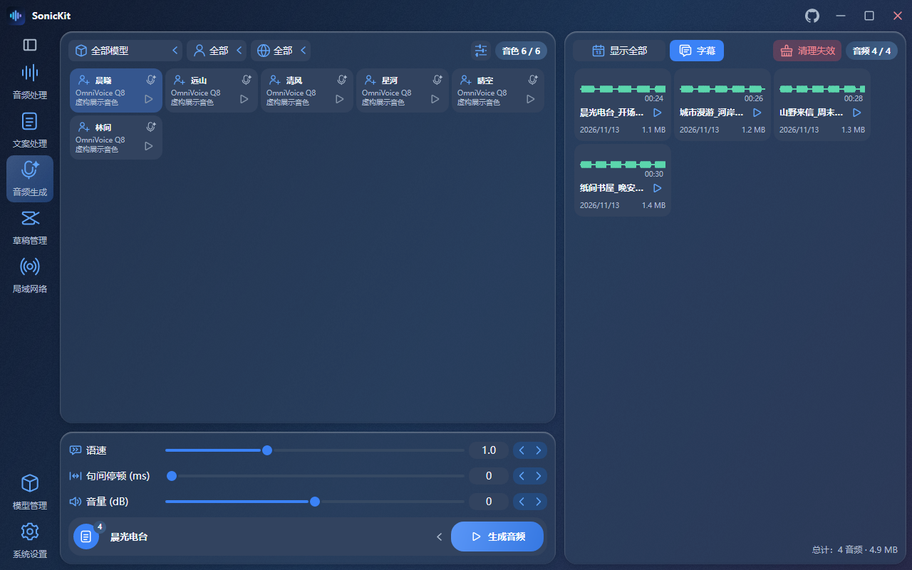
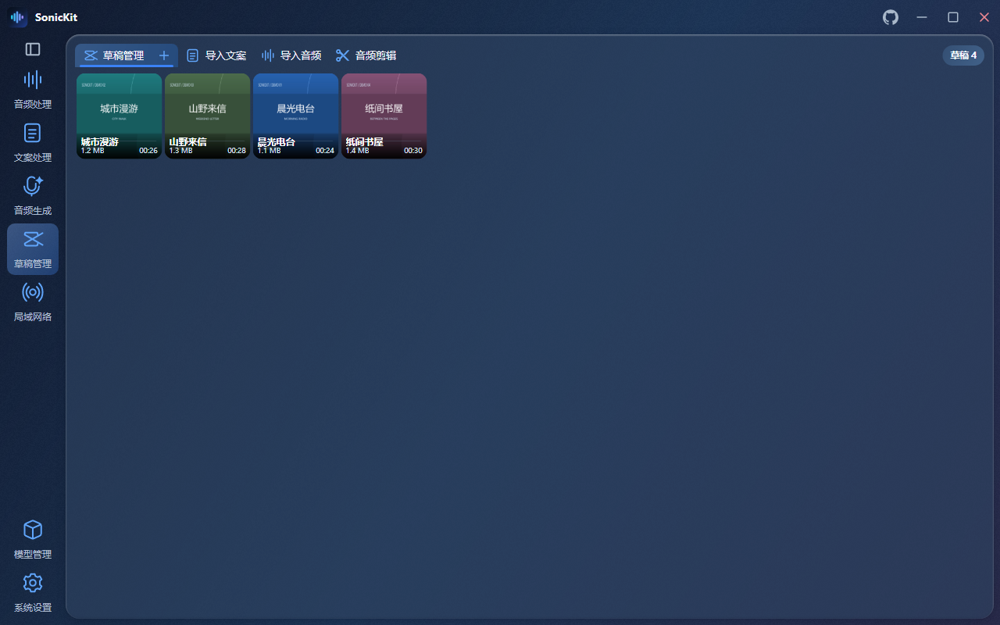
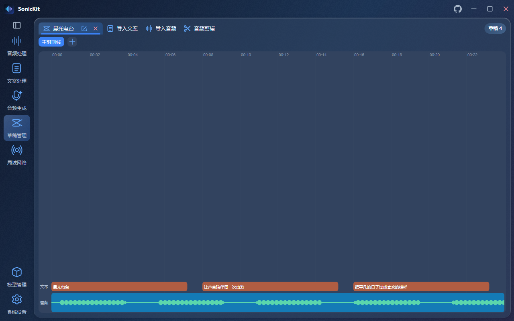
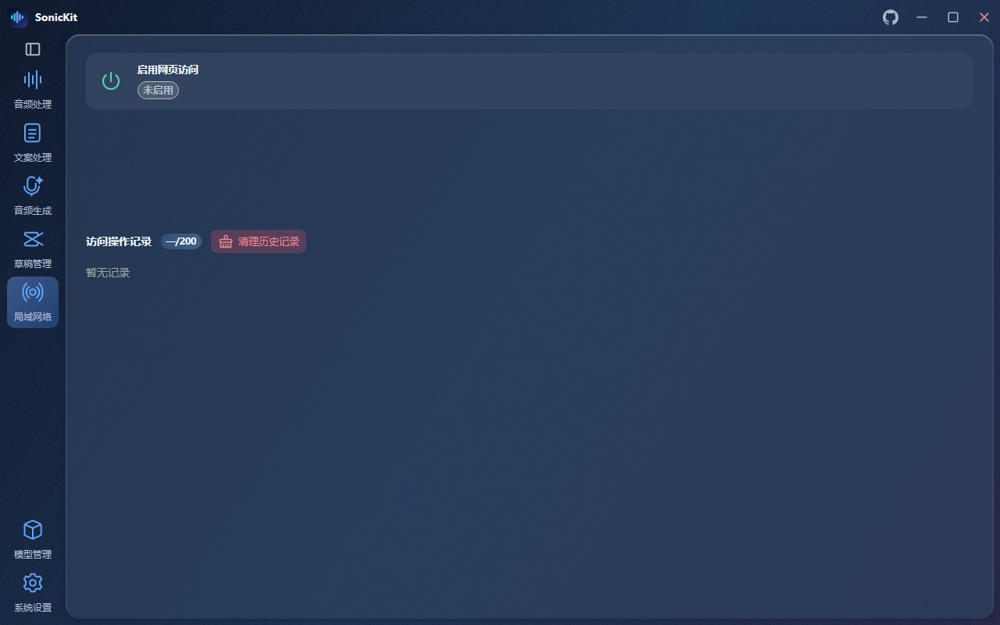
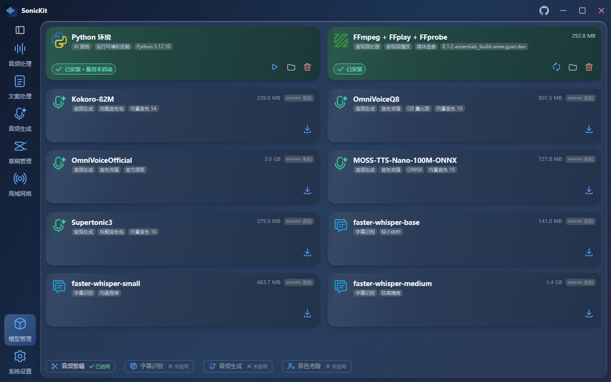
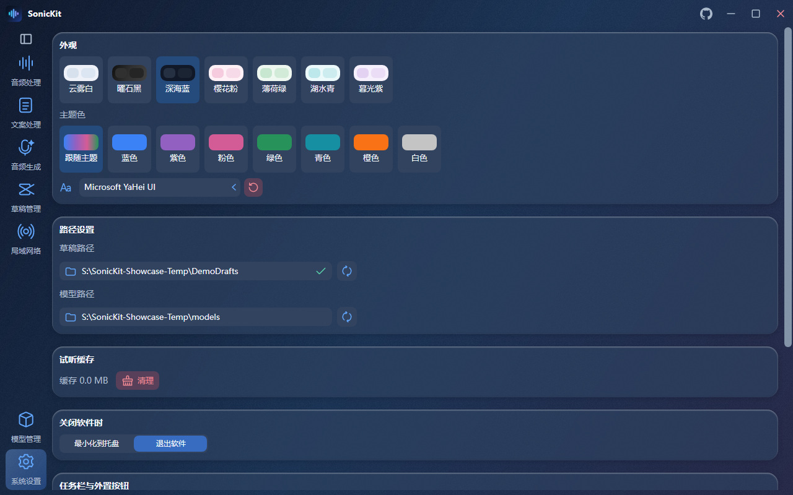

# SonicKit

**把文案、配音、字幕和草稿，放进同一个工作台。**

面向 Windows 的桌面音频工具，连接素材整理、气口剪辑、AI 配音、字幕识别与 CapCut 草稿工作流。

`音频剪辑` · `字幕识别` · `文案管理` · `AI 配音` · `音色克隆` · `草稿管理` · `局域网访问`

[音频处理](#音频处理) · [字幕识别](#字幕识别) · [文案处理](#文案处理) · [音频生成与音色管理](#音频生成与音色管理) · [草稿管理](#草稿管理) · [局域网络](#局域网络) · [模型管理](#模型管理) · [系统设置](#系统设置)

## 可以用它做什么

| 板块 | 基础功能 |
| --- | --- |
| 音频处理 | 导入音视频、查看波形、预览静音剪辑、批量导出音频 |
| 字幕识别 | 按文件识别、编辑字幕、切换文案与 SRT、导出结果 |
| 文案处理 | 多列表整理、逐篇编辑、按日期回看、衔接配音和草稿导入 |
| 音频生成 | 选择音色、调整语速与音量、逐篇批量配音、管理音频库 |
| 音色管理 | 按模型、语言、性别筛选，试听、克隆及导入导出自定义音色 |
| 草稿管理 | 浏览 CapCut 草稿、查看时间线和素材、导入音频与文案 |
| 局域网络 | 手动开启 HTTPS 网页，让同一局域网的设备使用部分处理功能 |
| 模型管理 | 检测、下载和卸载模型，管理 Python 环境及 FFmpeg 工具 |
| 系统设置 | 切换主题与字体、设置数据路径、配置托盘和外置按钮 |

## 音频处理

导入口播、访谈或视频素材，在波形上查看停顿，再按需要缩短静音区间。

- **文件与文件夹导入**：集中整理素材，按全部、视频或音频筛选处理集合。
- **气口剪辑**：调整静音分贝、静音最短时长与切口保留，也可直接选择快捷预设。
- **波形预览**：查看待剪区域，支持播放定位、缩放和平移，并显示时长与预计大小变化。
- **批量导出**：支持 WAV、FLAC、MP3，可选择同目录输出或集中导出到文件夹。

## 字幕识别

在同一个音频工作区完成识别、校对和导出，让字幕与素材保持对应。

- **全量或所选识别**：根据任务选择处理全部导入文件或当前文件。
- **两种显示格式**：在整段文案和带时间轴的 SRT 之间切换。
- **字幕校对与定位**：编辑当前文件的字幕，结合波形和播放位置查看内容。
- **结果复用**：导出 SRT 或 TXT，也可将识别文案加入文案列表。

## 文案处理

按栏目、项目或用途分组，把零散文字整理成可编辑、可配音、可导入草稿的文案。

- **多列表管理**：新建、重命名和删除列表，为不同项目分别整理内容。
- **逐篇编辑**：粘贴加入列表，选择条目后编辑正文，并查看文案数量与字数。
- **日期历史**：按日期查看已经保存的文案，方便回看与继续处理。
- **连接后续流程**：在音频生成页选择文案列表，也可将文字按片段规则导入草稿。

## 音频生成与音色管理

选好文案和音色，调整朗读参数，再将配音结果集中到音频库。

- **多种配音引擎**：接入 Kokoro、OmniVoice、MOSS-TTS-Nano 和 Supertonic3；可用能力取决于所选模型及运行组件。
- **音色选择与试听**：按模型、语言和性别筛选，以卡片查看并选择音色。
- **音色克隆**：通过参考音频与可选参考文本创建自定义音色；支持单个 PT 文件的导入、导出与管理，具体支持范围取决于模型。
- **朗读参数**：调整语速、音量和句间停顿，按选定文案列表逐篇生成。
- **音频库**：按日期或分组查看结果，预览波形和字幕，并衔接草稿音频导入。

## 草稿管理

围绕 CapCut 草稿整理配音和文案，查看内容结构，再预览需要写入的片段。

- **草稿卡片**：浏览封面、名称、时长和大小，管理独立的草稿项目。
- **时间线与素材**：选择草稿和时间线，查看轨道、片段与素材信息。
- **导入音频与文案**：从音频库或文案列表准备内容，配置位置、间隔和分段方式，预览后确认写入。
- **草稿内音频剪辑**：预览静音剪辑结果后再确认修改。

## 局域网络

由桌面端手动开启网页访问，让同一局域网中的其他设备通过浏览器提交处理任务。

- **按需启停**：在桌面端控制服务，启用后查看 HTTPS 地址、证书指纹和在线会话。
- **浏览器处理**：网页提供气口剪辑、字幕识别、音频生成和只读模型信息。
- **文件上传与下载**：使用独立临时任务目录，处理结果通过浏览器下载。
- **访问记录**：在桌面端查看近期操作记录；网页功能是桌面能力的一个子集。

首次访问需要在访客设备上核对并信任主机证书，具体步骤见[局域网 HTTPS 访问说明](README.md#局域网-https-访问)。

## 模型管理

集中查看配音、识别和运行组件的状态，按实际需要准备本地环境。

- **模型检测**：选择模型目录，检测本地文件与安装状态。
- **下载与卸载**：在对应卡片执行下载、取消或卸载，并查看进度。
- **Python 环境**：管理软件使用的推理运行环境；部分引擎使用独立组件。
- **媒体工具**：集中管理 FFmpeg、FFprobe 和 FFplay。

模型和运行环境需要单独准备，不随软件发布包提供。硬件压力提示是配置估算，实际速度取决于模型、设备和素材。

## 系统设置

让工作台的外观、路径和日常交互适应自己的使用习惯。

- **外观**：提供七种主题，并可选择主题色和界面字体。
- **路径**：设置模型目录与 CapCut 草稿目录。
- **日常使用**：选择关闭时退出软件或最小化到托盘，管理试听缓存。
- **辅助入口**：配置复制文字后的外置文案导入按钮，以及任务栏信息显示。
- **系统信息**：查看硬件与占用情况；可显示的信息取决于设备和驱动支持。

## 一个常见的使用流程

1. **整理文案**：为栏目建立列表，粘贴内容并逐篇编辑。
2. **生成配音**：选择列表、音色和朗读参数，逐篇生成音频。
3. **处理素材**：检查波形，按需要缩短静音区间。
4. **准备字幕**：识别或编辑字幕，导出 SRT，或将文字继续加入文案列表。
5. **导入草稿**：选择 CapCut 草稿和时间线，预览音频、字幕或文字片段后确认写入。

## 开始使用

SonicKit 面向 Windows 桌面使用，界面采用 Avalonia，配合 C# 业务层、Rust 计算引擎和 Python 推理服务。

安装与源码运行、模型目录要求及发布方式见[项目说明](../README.md)；详细功能范围见[功能矩阵](../docs/FEATURE_MATRIX.md)。使用 CapCut 草稿写入功能前，建议先备份需要编辑的草稿。

截图与演示素材说明

本页图片由现有 SonicKit 程序集渲染真实界面，使用独立临时目录与新制作的数据。文案、栏目名、草稿名、封面和音色名称均为本次演示创建，没有使用个人已有的音色、草稿或音频。

音色卡片为虚构展示条目；音频为数学合成的测试信号，字幕为手写演示文本，用于展示波形、列表、字幕与时间线布局，不作为语音模型音质、克隆效果或识别准确率的样例。局域网服务在截图中保持关闭，模型卡片展示隔离目录中的状态。

